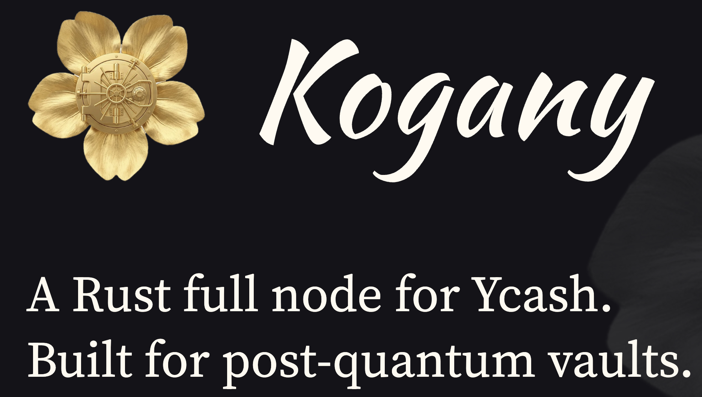

<p align="center">
  
</p>

# Kogany: the Ycash node in Rust (`koganyd`)

**Kogany** is the Ycash developers' Ycash full node in Rust. The name is a play on the Japanese
word _kogane_ (黄金, "gold"): the node carries the Ycash Yellowback (YED) upgrade with **vaults**,
so the Ycash contributors called it Kogany. The codebase began as [Zakura](README-zakura.md), a
consensus-compatible Zcash full node in Rust (Zebra lineage); on that baseline the Ycash
contributors added the vault network upgrade and made the node compatible with the Ycash network.

Built with the `ycash` cargo feature, the tree is **Kogany**, a Ycash full node, `koganyd`: it
follows Ycash mainnet, the re-forked Ycash testnet and Ycash regtest, and it enforces the vault
network upgrade and the Ycash Yellowback (YED) rule module on top of Ycash consensus. Yellowback
is a decentralized dollar on Ycash; YED is its unit.

Built without the feature, the tree is upstream Zakura, a Zcash node (`zakurad`), and runs
Zakura's own tests unchanged. Upstream's README is kept as
[README-zakura.md](README-zakura.md), and Zakura's design documents under [`docs/`](docs/) still
describe the node's architecture; this file covers what is different on Ycash. In code and
paths the name is lowercase: the repository and cargo package are `kogany`, the daemon is
`koganyd`, the data directory is `~/.kogany`.

- [The three Ycash node lines](#the-three-ycash-node-lines)
- [Building](#building)
- [Versioning](#versioning)
- [Networks, ports and identifiers](#networks-ports-and-identifiers)
- [Directories and files](#directories-and-files)
- [Running](#running)
- [Yellowback and vault RPCs](#yellowback-and-vault-rpcs)
- [Upstream documentation](#upstream-documentation)
- [License](#license)

## The three Ycash node lines

Ycash Yellowback (YED) and the vault network upgrade are implemented on three node lines, which
enforce the same rules and the same branch ID (`0x6d5b7a31`, the `Vault` network upgrade):

| Line | Codebase | Role |
| --- | --- | --- |
| `ycash-dd` | ycashd 4.5.0 (C++, Zcash 4.5 lineage) | the primary Yellowback line |
| `ycash6` | ycashd 6.20 (C++, Zcash 6.x lineage) | the release line (6.22.x for the vault upgrade) |
| kogany | Zakura (Rust, Zebra lineage) | the third line: `koganyd`, this repository |

A rule change is made on every line together; the cross-line vectors in
[`testdata/yellowback/`](testdata/yellowback/) are byte-identical to ycash6's and pin the shared
behaviour. The Yellowback workspace (`AGENTS.md` there) holds the plans and the crosswalk.

## Building

`koganyd` is the `kogany` package's `ycash` build:

```sh
cargo build --release --locked -p kogany --bin koganyd --features ycash
```

The `ycash` feature switches the forked librustzcash crates (`zakura-common-ycash`, pinned in the
root `Cargo.toml` under `[patch.crates-io]`) to their Ycash values. The same build also links a
`zakurad` binary, which refuses to run: a Ycash node never runs, or installs, under Zcash's name.
Without the feature, `cargo build -p kogany` builds upstream's Zcash `zakurad` and no `koganyd`.

The container image is upstream's `docker/Dockerfile` with the same switch: with `ycash` in the
`FEATURES` build argument it builds and ships `koganyd` (and no `zakurad`), without it upstream's
`zakurad`. The image's default command, `node`, runs whichever is installed:

```sh
docker build -f docker/Dockerfile --target runtime --build-arg FEATURES="default-release-binaries ycash" -t koganyd .
docker run --rm --entrypoint koganyd koganyd --version
```

## Versioning

The package is `kogany` (cargo prints `Compiling kogany v1.8.0-rc1`); its directory,
`crates/zakurad`, and its library name, `zakurad`, stay upstream's so upstream syncs keep merging.
The version line is Zakura's: the package version is the Zakura version kogany tracks
(`1.8.0-rc1` now). The build metadata is kogany's own, counted from the tag
`kogany-ycash-baseline`, never from an upstream `v*` tag; for example:

```text
$ koganyd --version
koganyd 1.8.0-rc1+kogany.31.g4e67df4e3a1b
```

`31` is the number of commits since `kogany-ycash-baseline`
(`git describe --tags --match kogany-ycash-baseline --long`), `g…` the commit, and `.modified` is
appended for uncommitted changes. A build without `.git` (the Docker image) has no count and
prints `koganyd 1.8.0-rc1+kogany.g<commit>` from the commit it was given (`SHORT_SHA`). The same
version is in the startup diagnostics and the `kogany.build.info` metric. The user agent carries
the package version only, `/koganyd:1.8.0-rc1/`: ycashd keeps only `[A-Za-z0-9 .-/:]` of a peer's
subversion, so a `+` would be dropped. Upstream's `zakurad` (built without the `ycash` feature)
keeps Zakura's scheme.

## Ports

The one table of the ports kogany uses. A `koganyd` built with the `ycash` feature applies only
Ycash ports by default; it never binds a Zcash port unless a config names one.

| Network | kogany P2P | kogany RPC | Zcash P2P (not used) | Zcash RPC (not used) |
| --- | --- | --- | --- | --- |
| Mainnet | 8833 | 8832 | 8233 | 8232 |
| Testnet, `fast` profile (`network = "Testnet"`) | 18833 | 18832 | 18233 | 18232 |
| Testnet, `slow` profile (`network = "TestnetSlow"`) | 18933 | 18932 | 18233 | 18232 |
| Testnet, `legacy` profile (`network = "TestnetLegacy"`) | 19033 | 19032 | 18233 | 18232 |
| Regtest | 18344 | 18832 | 18344 | 18232 |

- The values equal ycashd's (`nDefaultPort`, `chainparamsbase.cpp`); the tests
  `parameters::ycash` in `zakura-chain` and `ycash` in `zakura-network` check them.
- P2P: the generated `kogany.toml` listens on `[::]:8833`. On a testnet or regtest write
  `listen_addr = "[::]"` (no port) and the port follows `network`, or name the port above.
- RPC: off until `rpc.listen_addr` is set; set it to the RPC port above, e.g. `127.0.0.1:8832`.
  Regtest and the `fast` testnet share 18832, as in ycashd.
- Regtest P2P 18344 is the one port Ycash shares with Zcash (zcashd's regtest port, kept by
  ycashd). Regtest is local only; to run a Zcash regtest node beside it, give one of them
  another `listen_addr`.
- `network = "TestnetLegacy"` is testnet-legacy (P2P 19033, magic `f77962d5`), the shadow fork with no Vault activation. ycashd 4.5.0's testnet3 is not a kogany network.
- Zcash peers: Ycash shares Zcash's mainnet and regtest network magic, so kogany cannot tell
  a Zcash peer by magic alone. It refuses a Zcash peer by protocol version (Ycash peers advertise
  at least 270013) and refuses any peer address on a Zcash port (8233, 8232, 18233, 18232), so a
  `koganyd` and a Zcash node run side by side on one host without a port or peer conflict.
- Docker: publish the Ycash ports, e.g. `docker run -p 8833:8833 koganyd` (add
  `-p 8832:8832` and `ZAKURA_RPC__LISTEN_ADDR=0.0.0.0:8832` for RPC). The compose files and
  configs under `docker/` are upstream's and use Zcash's ports for a Zcash `zakurad`.

## Networks and identifiers

Every value equals ycashd's (ycash6 `src/chainparams.cpp`, `src/chainparamsbase.cpp`); the test
`parameters::ycash::identity_tests` in `zakura-chain` checks them and checks that none collides
with a Zcash network's on one host.

| Network | P2P port | RPC port | Magic | `getblockchaininfo.chain` | `testnetprofile` |
| --- | --- | --- | --- | --- | --- |
| Ycash mainnet (`Mainnet`) | 8833 | 8832 | `24e92764` | `main` | |
| Ycash testnet, `fast` profile (`Testnet`) | 18833 | 18832 | `f77962d3` | `test` | `fast` |
| Ycash testnet, `slow` profile (`TestnetSlow`) | 18933 | 18932 | `f77962d4` | `test` | `slow` |
| Ycash testnet, `legacy` profile (`TestnetLegacy`) | 19033 | 19032 | `f77962d5` | `test` | `legacy` |
| Ycash regtest (`Regtest`) | 18344 | 18832 | `aae83f5f` | `regtest` | |

- The RPC server is off until `rpc.listen_addr` is set; the RPC ports above are the ones to set.
  Regtest and the `fast` testnet share 18832, as in ycashd.
- Ycash mainnet and regtest share Zcash's magic. A Zcash peer is refused by its protocol version
  and by its port ([Ports](#ports)), and the Zakura P2P v2
  overlay, which identifies a chain by its genesis hash, is off (decision K-11).
- User agent: `/koganyd:<package version>/`, e.g. `/koganyd:1.8.0-rc1/` ([Versioning](#versioning)).
- Addresses: transparent `s1…`/`s3…` on mainnet, `sm…` on the testnets and regtest; Sapling
  `ys…`, `ytestsapling…`, `yregtestsapling…`; post-quantum `sqf…`/`sqs…`, `tqf…`/`tqs…`,
  `rqf…`/`rqs…` (the scheme in the prefix: FN-DSA-512 / SLH-DSA, D-9); Yellowback (YED) `yb…`,
  `yt…`, `yr…`, post-quantum `ybf…`/`ybs…`, `ytf…`/`yts…`, `yrf…`/`yrs…`. Coin type 347 on mainnet.
- DNS seed: `seed.ycash.xyz` on mainnet; the testnet has fixed seeds only.
- ycashd 4.5.0's testnet3 is not one of kogany's networks.
- `network = "Testnet"` is testnet-yb-fast. `network = "TestnetSlow"` and
  `network = "TestnetLegacy"` are the shadow forks of mainnet through height 3,079,999.

## Directories and files

kogany never uses Zakura's names, so a Zcash `zakurad` and a Ycash `koganyd` (mainnet or testnet)
run on one host without sharing a file:

| What | `koganyd` default | Zcash `zakurad` default |
| --- | --- | --- |
| Config file | `kogany.toml` in the preference directory (`~/.config` on Linux, `~/Library/Preferences` on macOS) | `zakura.toml` (or a legacy `zebrad.toml`) |
| State, peer cache | `kogany/` in the cache directory (`~/.cache/kogany` on Linux, `~/Library/Caches/kogany` on macOS) | `zakura/` |
| RPC cookie | `<cache>/kogany/.cookie` on mainnet, `<cache>/kogany/<network>/.cookie` on the testnets and regtest | `<cache>/zakura/.cookie` |
| Network identity | `~/.kogany` | `~/.zakura` |

Environment overrides keep Zakura's `ZAKURA_` prefix (`ZAKURA_RPC__LISTEN_ADDR=127.0.0.1:8832`);
they apply to the process that reads them only.

## Running

`koganyd generate -o ~/.config/kogany.toml` writes the default configuration for mainnet
(Ycash seeds, the Ycash listen port, the paths above); edit it or start with no config at all:

```sh
koganyd start                       # Ycash mainnet, ~/.cache/kogany
koganyd -c testnet.toml start       # with [network] network = "Testnet": the fast profile
koganyd -c regtest.toml start       # with [network] network = "Regtest"
```

A minimal RPC section, for mainnet:

```toml
[rpc]
listen_addr = "127.0.0.1:8832"
```

On regtest every Ycash upgrade height, and the Vault height, come from
`[network.network.params.activation_heights]`, as ycashd's `-nuparams` set them; the regtest
harness in ycash6 (`qa/rpc-tests/test_framework/kogany.py`) writes that file for each node.

To start a mainnet node at a recent height instead of from genesis, restore a signed snapshot of
kogany's state: [`doc/mainnet-restore.md`](doc/mainnet-restore.md).

## Yellowback and vault RPCs

`koganyd` answers the stock Ycash RPCs as ycashd does, plus the vault primitive's `set_*` and
`vault_*` RPCs and the Yellowback `yed_*` RPCs, at `rpcversion` 9:

- [`doc/yellowback-spec.md`](doc/yellowback-spec.md): the vault upgrade and Yellowback
  specification, generated from the workspace plans;
- [`doc/yellowback-rpc-contract.json`](doc/yellowback-rpc-contract.json) and
  [`doc/vault-rpc-contract.json`](doc/vault-rpc-contract.json): the RPC contracts shared with
  ycash6 and ycash-dd;
- [`doc/kogany-rpc-openrpc.json`](doc/kogany-rpc-openrpc.json): kogany's OpenRPC document.

## Upstream documentation

- [README-zakura.md](README-zakura.md): upstream's README (installer, Docker image and
  instructions for the Zcash node).
- [`docs/`](docs/): Zakura's design, specs and decisions, unchanged.
- [CHANGELOG.md](CHANGELOG.md): kogany's entries first, then Zakura's.
- [`.github/README-kogany.md`](.github/README-kogany.md): which CI workflows run on kogany.
- `AGENTS.md`: upstream's contributor guidelines; the Yellowback workspace's rules come first.

## License

kogany, like Zakura, is distributed under the terms of both the MIT license and the Apache License
(Version 2.0). See [LICENSE-APACHE](LICENSE-APACHE) and [LICENSE-MIT](LICENSE-MIT).
